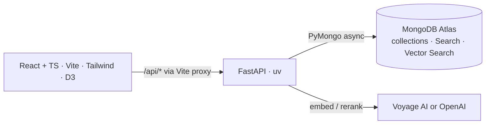

# MongoDB Demo Kit

The standard way to build MongoDB Atlas demos (Atlas Search, Vector Search, hybrid `$rankFusion`, Voyage AI, `$graphLookup`) that we share with prospects on GitHub.

- **Stack:** FastAPI + PyMongo async (uv) · React + TypeScript + Vite + Tailwind + D3 · one command: `npm run dev`
- **Design:** [demo-kit-standard-design.md](demo-kit-standard-design.md) · **Plan:** [demo-kit-standard-implementation.md](demo-kit-standard-implementation.md)


## Architecture



## Layout

```
template/            Setup-only starter, runnable on its own
modules/
  search-lab/        full-text vs vector vs hybrid vs rerank   { api/, web/, module.json }
  graph-view/        $vectorSearch + $graphLookup + D3 graph   { api/, web/, module.json }
scripts/
  new-demo.mjs       npm run new -- <name> [--modules a,b] [--out <dir>] [--skip-install]
  add-module.mjs     node <kit>/scripts/add-module.mjs <module>   (run inside a demo)
  spike/             T02 spike scripts (Atlas + providers)
docs/                spike notes, smoke checklist
```

## Create a demo

Prerequisites: Node 22+, [uv](https://docs.astral.sh/uv/), an Atlas 9.0 cluster (M10+ recommended).

```bash
npm run new -- acme-search --modules search-lab,graph-view --out ~/demos
cd ~/demos/acme-search
npm run dev
```

The generated repo is standalone (no runtime link to the kit). It contains the template, the selected modules under `api/app/modules/<name>/` and `web/src/modules/<name>/`, regenerated `web/src/core/api-types.ts`, and a README with a "Where's the MongoDB code?" table built from each module's `codeMap`.

**Blank starter:** omit `--modules` to get only the Setup page, core API/web, tests, linting and CI-ready tooling, as a starting point for a new project with its own design and datasets:

```bash
npm run new -- demo-starter --out ~/demos
```

Its README includes a "Build your own module" guide. Kit modules can still be added later with `add-module`.

Add a module later:

```bash
cd ~/demos/acme-search
node ~/src/mongodb-demo-kit/scripts/add-module.mjs graph-view
```

## Write a module

```
modules/<name>/
  module.json        name, requires, python, npm, collections, minServerVersion, codeMap
  api/               copied to api/app/modules/<name_with_underscores>/
    router.py        `router = APIRouter(prefix="/api/<name>")`; use `require_ready`, return `{ results, pipeline, timings }`
    seed.py          collections(), generate(rng), embed_fields
    indexes.py       regular(), search(), vector(dims)
    pipelines.py     pure pipeline builders
    tests/
  web/               copied to web/src/modules/<name>/
    index.tsx        export const route = { path, element }; export const navItem = { label, order }
```

Both sides are auto-discovered; copying the folders installs the module. Python module folders use underscores (`search_lab`) because they are packages; URLs and web folders keep dashes.

## Develop the kit

```bash
npm test                                   # scaffolding tests
cd template && npm i && npm test           # template unit tests (pytest + Vitest)
npm run new -- dev --modules search-lab,graph-view --out /tmp && (cd /tmp/dev && npm test)
```

CI ([.github/workflows/ci.yml](.github/workflows/ci.yml)) generates a demo with all modules and runs ruff, pyright, ESLint, tsc, pytest, Vitest and the build, and fails if `template/web/src/core/api-types.ts` is stale. Set `MONGODB_URI_TEST`, `TEST_VOYAGE_KEY` and `TEST_OPENAI_KEY` repo secrets to also run the integration tests.
