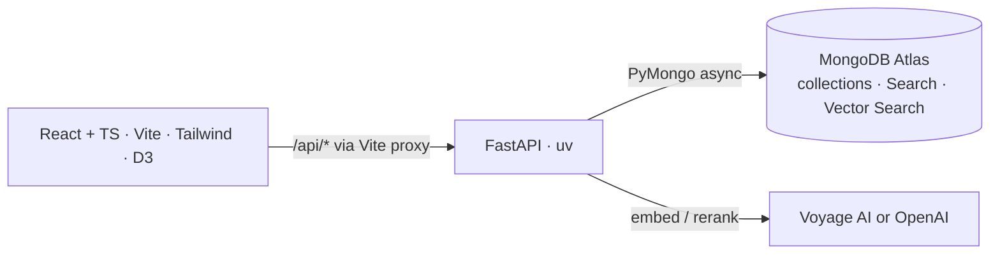

# {{DEMO_NAME}}

A MongoDB Atlas demo built with the MongoDB Demo Kit. Synthetic data only.

<!-- Screenshot slot: record docs/demo.gif, then replace this comment with  -->

## What it demonstrates

<!-- features:start -->
<!-- features:end -->

Every query shows the exact aggregation pipeline it ran (**Query** button), with timings and optional `explain()`.

## Architecture



## Prerequisites

- [Node.js 22+](https://nodejs.org/)
- [uv](https://docs.astral.sh/uv/getting-started/installation/) (installs Python 3.12 for you)
- A MongoDB Atlas cluster running **MongoDB 9.0**, **M10 or larger** recommended, with your IP on the access list
- An embedding API key: a Voyage AI [model API key from Atlas](https://www.mongodb.com/docs/voyageai/management/api-keys/) or an OpenAI key

## Quick start

```bash
npm install
npm run dev
```

1. Open <http://127.0.0.1:5173> → **Setup**. Paste your connection string and API key, then **Save** and **Test Connections**. The **Database Status** panel then shows whether the database, each module's collections and their indexes already exist.
2. Click **Seed Database**, then **Create Indexes** and wait until all indexes are ready.
3. Open the demo pages in the nav.

Settings are stored server-side in `api/config/settings.json` (gitignored, mode `0600`) and are never sent back to the browser unmasked. You can prefill them by copying `.env.example` to `.env`.

## Where's the MongoDB code?

<!-- codemap:start -->
<!-- codemap:end -->

## Development

| Command | What it does |
|---|---|
| `npm run dev` | API on `127.0.0.1:8000` + Vite on `127.0.0.1:5173` |
| `npm test` | pytest + Vitest. `MONGODB_URI_TEST=... npm run test:api` also runs Atlas integration tests |
| `npm run lint` / `npm run typecheck` | ruff + ESLint / pyright + tsc |
| `npm run gen:types` | Regenerate `web/src/core/api-types.ts` from the FastAPI schema |
| `npm run build` | Production build of the web app |

To re-theme the demo for a prospect, edit the module's `seed.py` (vocabulary), `indexes.py` and UI labels, then re-seed.

## Design with AI agents

This repo ships GitHub Copilot instructions and skills (in `.github/`) that turn a rough idea into a validated design and implementation plan for a new module, whether you start from the blank starter or from installed modules. Prerequisites: VS Code with GitHub Copilot Chat in agent mode. Copilot discovers everything in `.github/` automatically.

Open Copilot Chat and run:

```
/brainstorm A demo for a retail prospect: semantic product search with filters and a "similar items" graph
```

The agent then:

1. **Gathers context**: this README, `docs/plans/`, the installed modules and recent commits.
2. **Asks one question at a time** (mostly multiple choice): audience, story, MongoDB capabilities to show, data shape and volume.
3. **Proposes 2-3 approaches** with trade-offs and a recommendation (for example re-theme an installed module vs. build a new one).
4. **Presents the design in 200-300 word sections**, mapped onto the module contract below (`seed.py`, `indexes.py`, `pipelines.py`, `router.py`, web page), and asks for approval after each.
5. **Saves the design** to `docs/plans/YYYY-MM-DD-<topic>-design.md`.
6. **Offers an implementation plan** (`docs/plans/YYYY-MM-DD-<topic>-implementation.md`) of small, testable tasks you can then ask the agent to implement.

Tips: keep the first prompt short; push back if an approach feels wrong; say "skip" to move past a question or "go back" to revisit a section. The `brainstorming` skill is also picked up automatically when you ask the agent to design or plan a feature.

Put prospect reference material (sample files, screenshots, notes) in the `TempAssets/` folder created with this demo: it is gitignored, so you can point the agent at it without committing it. Seed data must stay synthetic.

Customize the workflow in `.github/copilot-instructions.md` (project context and conventions) and `.github/skills/*/SKILL.md` (the process).

## Build your own module

A module is a pair of folders that are discovered automatically: copy them in, restart `npm run dev`, and the module's API routes, seed data, indexes and nav entry appear.

```
api/app/modules/<name>/        Python package (use underscores, e.g. my_feature)
  __init__.py
  router.py      router = APIRouter(prefix="/api/<name>")      required
  seed.py        collections(), generate(rng), embed_fields      optional
  indexes.py     regular(), search(), vector(dims)               optional
  pipelines.py   pure functions that build aggregation pipelines
web/src/modules/<name>/
  index.tsx      export const route = { path, element }; export const navItem = { label, order }
```

- **`seed.py`**: `generate(rng)` returns `{collection: [docs]}` using the seeded `random.Random` so data is deterministic. Fields listed in `embed_fields = {"collection": ["title", "description"]}` are embedded into `embedding` during **Seed Database**. Seeding drops and recreates only the collections from `collections()`.
- **`indexes.py`**: return dicts like `{"collection": "items", "name": "items_vector", "definition": {...}}`. `vector(dims)` receives the dimensions of the model the data was embedded with.
- **`router.py`**: add `Depends(require_ready)` (from `app.core.meta`) so endpoints return `409` until data is seeded and indexed, run pipelines with `run_pipeline()` and return `QueryResponse` (`app.core.query`) so the UI's Query Drawer can show the exact pipeline, timings and `explain()`.
- **Web**: call the API with `api.post()` from `web/src/core/api.ts` and type responses with `Schemas['...']` after running `npm run gen:types`. Reuse `QueryDrawer` from `web/src/core/QueryDrawer.tsx`.
- Put tests next to the code (`api/app/modules/<name>/tests/`, `*.test.tsx`); `npm test` picks them up.

Then **Seed Database** and **Create Indexes** on Setup, and the module's nav entry becomes active.

Notes: this is a local, single-user demo (no auth) bound to `127.0.0.1`. Seed and index jobs run in memory, so a code reload during seeding aborts the job: run Seed again. Tested on macOS and Linux; on Windows the settings file permissions are not enforced.

## License

[Apache-2.0](LICENSE)
