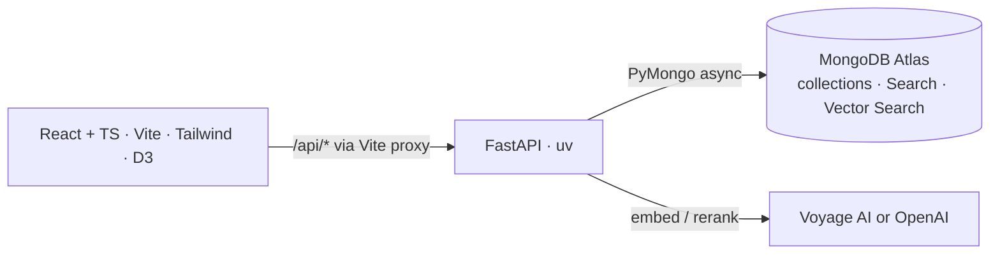

# {{DEMO_NAME}}

A MongoDB Atlas demo built with the MongoDB Demo Kit. Synthetic data only.

<!-- Screenshot slot: record docs/demo.gif, then replace this comment with  -->

## What it demonstrates

<!-- features:start -->
<!-- features:end -->

Every query shows the exact aggregation pipeline it ran (**Query** button), with timings and optional `explain()`.

## Architecture



## Prerequisites

- [Node.js 22+](https://nodejs.org/)
- [uv](https://docs.astral.sh/uv/getting-started/installation/) (installs Python 3.12 for you)
- A MongoDB Atlas cluster running **MongoDB 9.0**, **M10 or larger** recommended, with your IP on the access list
- An embedding API key: a Voyage AI [model API key from Atlas](https://www.mongodb.com/docs/voyageai/management/api-keys/) or an OpenAI key

## Quick start

```bash
npm install
npm run dev
```

1. Open <http://127.0.0.1:5173> → **Setup**. Paste your connection string and API key, then **Save** and **Test Connections**.
2. Click **Seed Database**, then **Create Indexes** and wait until all indexes are ready.
3. Open the demo pages in the nav.

Settings are stored server-side in `api/config/settings.json` (gitignored, mode `0600`) and are never sent back to the browser unmasked. You can prefill them by copying `.env.example` to `.env`.

## Where's the MongoDB code?

<!-- codemap:start -->
<!-- codemap:end -->

## Development

| Command | What it does |
|---|---|
| `npm run dev` | API on `127.0.0.1:8000` + Vite on `127.0.0.1:5173` |
| `npm test` | pytest + Vitest. `MONGODB_URI_TEST=... npm run test:api` also runs Atlas integration tests |
| `npm run lint` / `npm run typecheck` | ruff + ESLint / pyright + tsc |
| `npm run gen:types` | Regenerate `web/src/core/api-types.ts` from the FastAPI schema |
| `npm run build` | Production build of the web app |

To re-theme the demo for a prospect, edit the module's `seed.py` (vocabulary), `indexes.py` and UI labels, then re-seed.

Notes: this is a local, single-user demo (no auth) bound to `127.0.0.1`. Seed and index jobs run in memory, so a code reload during seeding aborts the job: run Seed again. Tested on macOS and Linux; on Windows the settings file permissions are not enforced.

## License

[Apache-2.0](LICENSE)
